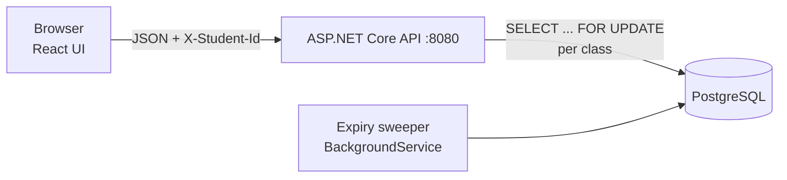
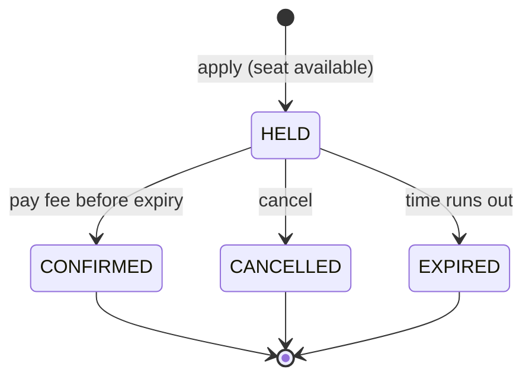

# Onnorokom School Admission System

Online admission system for a school where seats are given **first-come, first-served** (no lottery).
Applying holds a seat for a limited time; paying the admission fee within that time confirms it.
If the time runs out, the seat is released automatically for the next applicant.

| | |
|---|---|
| **Backend** | .NET 8 Web API, EF Core, PostgreSQL (`backend/`) |
| **Frontend** | React 18, Vite, TypeScript, TanStack Query (`frontend/`) |
| **Runtime** | Docker Compose — Docker is the only thing you need to install |

> **Status:** in development. Sections marked _(pending #N)_ are filled in by the PR that closes issue N.

---

## Quick start

_(pending #4)_

```bash
git clone https://github.com/TashrifRashidSourav/onnorokom-school-admission-system.git
cd onnorokom-school-admission-system
docker compose up --build
```

| Service | URL |
|---|---|
| Frontend | http://localhost:3000 |
| Backend API | http://localhost:8080 |
| PostgreSQL | `localhost:5432` (inside compose: `db:5432`) |

Stop with `docker compose down`. Data is kept in a named volume and survives `down` / `up`.
`docker compose down -v` deletes it.

## Configuration

All settings come from environment variables. Defaults are in `docker-compose.yml`; override them in a `.env` file (see [`.env.example`](.env.example)).

| Variable | Used by | Default | Purpose |
|---|---|---|---|
| `ConnectionStrings__Default` | backend | points at the `db` service | PostgreSQL connection |
| `HOLD_DURATION_SECONDS` | backend | `600` | How long a seat stays held before it expires |
| `API_URL` | frontend | `http://localhost:8080` | Backend URL used by the browser, applied at container start (no rebuild) |

## Running the tests

_(pending #13, #19)_

```bash
# Backend tests, including the concurrency test (uses its own test database)
docker compose --profile test run --rm backend-tests

# Frontend tests (bonus)
docker compose --profile test run --rm frontend-tests
```

## How it works



Hold lifecycle:



- **No overbooking:** creating a hold locks the class row in PostgreSQL, so `held + confirmed` can never exceed `totalSeats`, even with several backend processes on one database.
- **Automatic release:** an expired hold stops counting the moment its time is up; nobody has to call an API.
- **Idempotent payment:** confirming the same hold twice counts the seat once.

Details and the reasoning behind each decision are in [ASSUMPTIONS.md](ASSUMPTIONS.md).

## API

Base URL `http://localhost:8080`. All requests and responses are JSON. The student is identified by the `X-Student-Id` header (17-digit birth registration number).

| # | Method | Path | Purpose | Success |
|---|---|---|---|---|
| 1 | `POST` | `/classes` | Create a class (one shift = one class) | `201` |
| 2 | `GET` | `/classes` | List classes with seat counts | `200` |
| 3 | `GET` | `/classes/{classId}` | Seat counts for one class | `200` |
| 4 | `POST` | `/classes/{classId}/holds` | Apply (hold a seat) | `201`, `409` if full |
| 5 | `GET` | `/holds/{holdId}` | Current status of an application | `200` |
| 6 | `POST` | `/holds/{holdId}/confirm` | Pay the fee, confirm admission | `200` |
| 7 | `DELETE` | `/holds/{holdId}` | Cancel an application | `204` |
| 8 | `GET` | `/me/holds` | All applications of this student | `200` |

Errors always look like `{ "error": "<code>", "message": "<explanation>" }`. Invalid input returns `4xx`, never `500`.

## Project structure

```
backend/     .NET 8 solution: src/Admission.Api, tests/Admission.Tests, Dockerfile
frontend/    React + Vite app, Dockerfile (nginx + runtime config)
docker-compose.yml
```

## Documentation

- [ASSUMPTIONS.md](ASSUMPTIONS.md): decisions where the brief left room
- [AI_USAGE.md](AI_USAGE.md): which AI tools were used, where, and what they got wrong
- [CONTRIBUTING.md](CONTRIBUTING.md): branch, commit and pull-request rules
- [PLAN.md](PLAN.md): design and issue-by-issue plan
